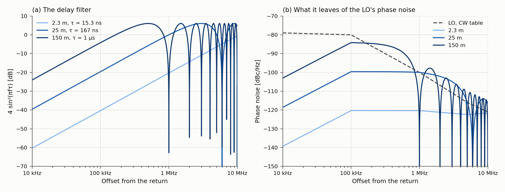
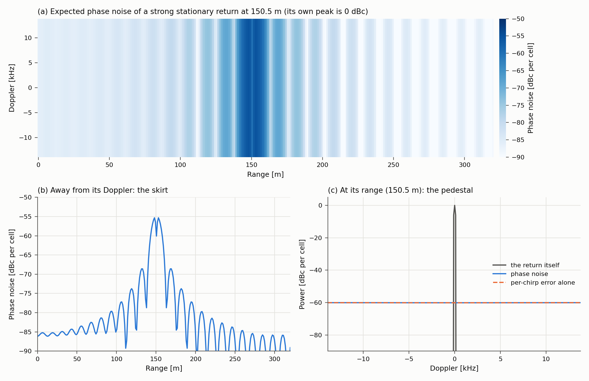
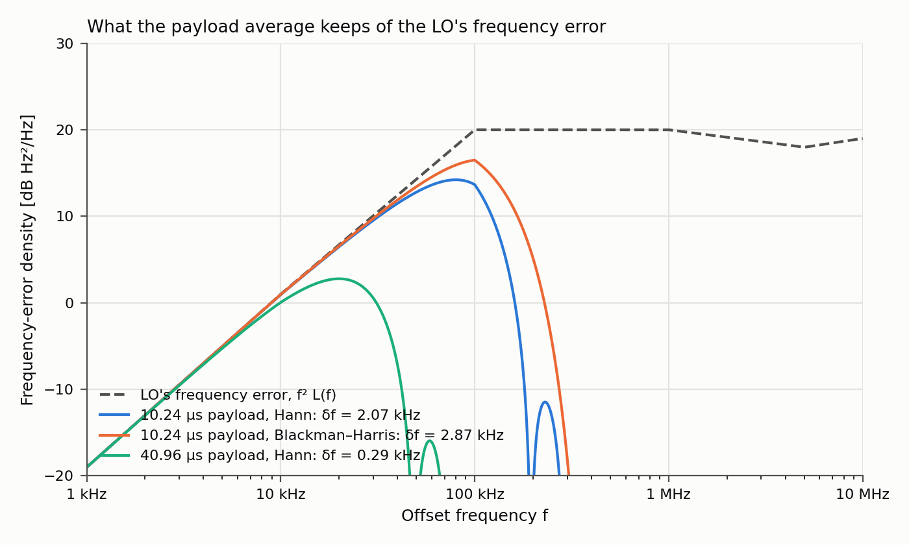
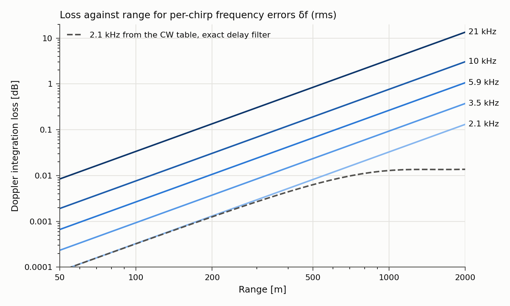
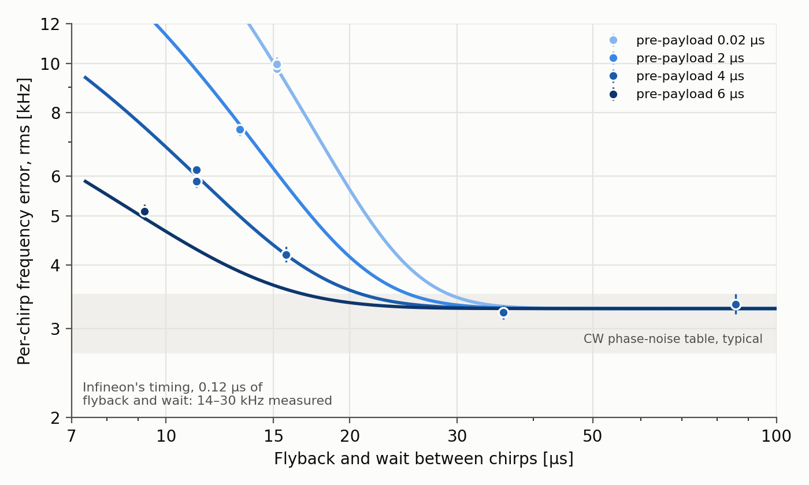

# Phase noise in a 77 GHz FMCW radar

The local oscillator (LO) of a radar is not a perfect tone: its phase wanders
at random. This page explains what that does to the range–Doppler output of
an FMCW radar, which of the effects matter for range performance, and how the
toolbox models each of them. It derives the formulas the models use, so that
their assumptions and limits are visible.

Numbers come from the CTRX8188F datasheet [1, 2] and the CARKIT validation
study [3], which measured one CTRX8188F radar against these models. Unless
stated otherwise, the examples use the CTRX8188F's typical 76–77 GHz table and
a waveform like the CARKIT captures: a 10.24 µs sampled ramp (the payload) of
512 samples at 50 MS/s, 11.67 MHz/µs, 256 chirps every 36 µs, Hann windows.
`examples/phase_noise_figures.py` draws the figures. How to predict a strong
return's phase noise in range and Doppler with `phase_noise_fft` is described
in [phase_noise_prediction.md](phase_noise_prediction.md).

## In brief

- **TX and RX share the LO, so most of its noise cancels.** A return carries
  the difference between the LO's phase now and its phase one round trip ago.
  Fluctuations slower than the round trip cancel.
- **The processing splits what remains in two.** Fluctuations slower than the
  sampled ramp rotate a whole chirp: one phase error per chirp. Faster ones
  spread the return into other range cells: a skirt.
- **The per-chirp part costs every target some Doppler integration gain.** Its
  phase is 2πτ·δf, where τ is the round-trip delay and δf a frequency error per
  chirp that all returns share. The sum over chirps keeps $e^{-\sigma^2}$ of the peak
  power, with σ = 2πτ·δf in rms. The link budget carries this as
  `SystemLosses.chirp_frequency_error_rms_hz`. For the CTRX8188F's CW phase
  noise it is negligible: with a 10 µs payload and a Hann window δf is
  2.1 kHz, which costs 0.03 dB at 1 km.
- **The chirp timing can make it matter.** If the synthesizer has too little
  time between ramps, δf grows. On one CTRX8188F radar it stayed at the CW
  level with 15–25 µs of flyback and wait, and reached 14–30 kHz with 0.12 µs:
  1.5–7 dB at 1 km.
- **The fast part is a skirt around strong returns.** It is white over Doppler
  and spreads over range, and it scales with the return, so only strong returns
  matter. The link budget leaves it out; `phase_noise_fft` predicts it.
- **Every channel carries the same noise.** The pedestal and skirt of a strong
  return have that return's spatial signature, so summing channels towards it
  gains nothing against them.

## Phase noise and how it is specified

An LO with phase noise is

$$
s(t) = \cos\big(2\pi f_0 t + \varphi(t)\big),
$$

with φ(t) a small, random, stationary phase. In a chirp, 2πf₀t becomes the
ramp's phase and φ adds to it. For small φ,
s ≈ cos(2πf₀t) − φ(t) sin(2πf₀t): the carrier plus the spectrum of φ moved to
either side of it.

Datasheets give the single-sideband phase noise L(f): the power in one
sideband at offset f from the carrier, per hertz, relative to the carrier, in
dBc/Hz. In the small-angle picture each sideband has the density of φ itself,
so the linear value of L(f) is the two-sided power spectral density (PSD) of φ
in rad²/Hz. IEEE Std 1139 [4] defines L(f) as half the one-sided PSD, which is
the same thing. The phase variance between offsets f₁ and f₂ counts both signs:

$$
\sigma_\varphi^2 = 2\int_{f_1}^{f_2} L(f)\,df .
$$

The toolbox uses this convention throughout. The linear value of L(f) is the
density at each signed offset, with no further factor of two per sideband.

The LO's instantaneous frequency error is δf(t) = φ′(t)/2π. Differentiating
multiplies a spectrum by (2πf)², so the PSD of δf is

$$
S_{\delta f}(f) = f^2\,L(f) \quad [\mathrm{Hz^2/Hz}].
$$

Two frequencies appear here, and they are easy to confuse. The offset f says
how fast the error fluctuates, and every density on this page is over f. The
frequency error δf is the size of the error at an instant, in hertz.
Integrating S_δf over f gives the variance of δf in Hz².

The CTRX8188F datasheet specifies L(f) at the TX port in CW mode, at five
offsets [1, Table 22]:

| Offset | 76–77 GHz typ / max | >77–81 GHz typ / max |
|---|---|---|
| 10 kHz | −79 / −73 | −78 / −73 |
| 100 kHz | −80 / −75 | −78 / −73 |
| 1 MHz | −100 / −97 | −98 / −95 |
| 5 MHz | −116 / −111 | −114 / −109 |
| 10 MHz | −121 / −115 | −120 / −114 |

All entries are in dBc/Hz. `radarperf.phase_noise.ctrx8188f_phase_noise`
holds the table and interpolates it linearly in dB against log offset. Over
10 kHz–10 MHz the typical 76–77 GHz table integrates to 3.9·10⁻³ rad², or
62 mrad (3.6°) rms. That is the LO's own jitter. A return sees far less of it
at short range, as the next sections show. The datasheet gives no phase noise
while chirping.

## Where it comes from in the MMIC

In the CTRX8188F, a digital PLL (DPLL) locks to an external 50 MHz crystal
and synthesizes the LO at one sixth of the RF frequency, 12.7–13.5 GHz for
76–81 GHz. A ×2 multiplier follows (its output also feeds the LOOUT pin for
cascading), then a ×3 multiplier towards the TX and RX chains [1, Figure 2].
The static frequency step, 50 MHz/2¹⁶ × 6 = 4.58 kHz, confirms the overall
×6 [1, Table 23]. One LO chain feeds every TX and RX channel.

- **Frequency multiplication raises phase noise.** Multiplying the frequency
  by N multiplies the phase by N and its PSD by N²: 15.6 dB for ×6.
- **The loop shapes the spectrum.** Within its loop bandwidth, a PLL makes
  the oscillator follow the reference. There the noise is the reference's and
  the phase detector's, multiplied up, and roughly flat. Outside the loop
  bandwidth the oscillator's own noise takes over and falls, typically by
  20 dB per decade. The CTRX8188F table has that shape: at 76–77 GHz it is
  flat at −79 to −80 dBc/Hz up to 100 kHz, then falls 20 dB per decade to
  1 MHz. That
  suggests a loop bandwidth between 100 kHz and a few hundred kHz. The
  datasheet does not state it; this is read from the shape.
- **Chirping moves the loop's set point.** The ramp sequencer steps the DPLL's
  frequency command along each ramp, and the loop follows it. Between ramps it
  commands the jump back to the start frequency (the flyback). The DPLL must
  be in fast-settling mode during the flyback and the wait that follows, and
  in linear mode from the unsampled start of the ramp (the pre-payload) to its
  end [2, Table 120]. The CW table describes the loop holding one frequency.
  [Chirp timing and settling](#chirp-timing-and-settling) covers what happens
  when the loop has not settled from one ramp when the next begins.

Other 77 GHz MMICs follow the same outline: a crystal reference, a PLL around
a voltage-controlled oscillator, and frequency multiplication. Their
datasheets do not always give a full spectrum; the TI AWR2243 gives one
offset ([phase_noise_prediction.md: “Phase-noise data”](phase_noise_prediction.md#phase-noise-data)).

## The shared LO and the delay filter

The radar transmits the LO and mixes each echo with it. A return from range R
arrives τ = 2R/c later, so the mixer output's phase is the LO's phase now
minus its phase when the echo left:

$$
\Phi(t) - \Phi(t-\tau) = 2\pi f_b t + \text{const} + \varphi(t) - \varphi(t-\tau).
$$

The first part is the beat tone that encodes range, f_b = Sτ for chirp slope
S. The second is the residual phase noise, Δφ(t) = φ(t) − φ(t−τ). As a filter
acting on φ, its impulse response δ(t) − δ(t−τ) has the frequency response
$1 - e^{-j2\pi f\tau}$, so

$$
S_{\Delta\varphi}(f) = \left|1 - e^{-j2\pi f\tau}\right|^2 L(f) = 4\sin^2(\pi f\tau)\,L(f).
$$

Siddiq et al. derive the same delay filter for FMCW radar [5, Eq. 10].



*(a) The delay filter 4 sin²(πfτ) for three ranges. (b) The CTRX8188F's
typical 76–77 GHz CW table (dashed) and the residual phase noise it leaves at
those ranges, all of it taken as shared by TX and RX.*

- **Short delays cancel slow noise.** For fτ ≪ 1, 4 sin²(πfτ) ≈ (2πfτ)². At
  2.3 m (τ = 15.3 ns) this is −40 dB at 100 kHz and −20 dB at 1 MHz. Above
  100 kHz the filter rises about as fast as the table falls, so the residual
  is nearly flat, −120 to −122.5 dBc/Hz from 0.1 to 10 MHz.
- **Longer delays leave peaks and nulls.** Noise at offsets f = k/τ completes
  whole cycles over the round trip and cancels. At f = (k + ½)/τ the two
  phases are opposite, so their difference doubles: +6 dB. Averaged over f,
  4 sin²(πfτ) is 2. Once fτ ≫ 1 the TX and RX noise are uncorrelated and
  their powers add, 3 dB above the table. At 150 m (τ = 1.0 µs) the first null
  is at 1 MHz.
- **The table alone does not say what a return sees.** The LO is the same for
  every return, but each range has its own residual.

Noise that TX and RX do not share does not cancel. That could be noise added
in separate paths after the LO splits. It adds to the residual unfiltered.
The datasheet's table is measured at the TX port and does not say how much of
it is shared. The toolbox's `SingleReturnPhaseNoise` takes a `shared` and an
`independent` spectrum, and the examples assign the whole table to `shared`.
The CARKIT chamber measurement supports that [3, NOTES.md: “The chamber
reflector's skirt”]. A strong return's skirt was flat from 1 to 12 MHz offset,
as the delay-filtered table predicts. Unshared noise would have followed the
table itself and fallen by about 18 dB over that span.

## Two time scales in a frame

The range FFT maps an offset f from a return's beat frequency to a distance
Δr = cf/(2S) from the return. One range cell, without zero padding, is 1/T in
beat frequency, where T is the sampled payload: 97.7 kHz for 10.24 µs. The
processing therefore splits the residual by offset:

- **Slow fluctuations, below about 1/T,** change little over the payload. They
  rotate the return's whole chirp, so the return comes out in its own range
  cell with one extra phase per chirp. That phase changes from chirp to chirp
  and acts in slow time, on the Doppler FFT.
- **Fast fluctuations, above about 1/T,** change within the chirp. They put
  sidebands at other beat frequencies, in other range cells: a skirt around the
  return in range.

The boundary is the range window's frequency response, derived in the next
section. Each half costs the return itself some power, which leaves its
range–Doppler cell. The power reappears as a pedestal along Doppler at the
return's range, and as a skirt over range.



*`phase_noise_fft` for a stationary return at 150.5 m with the CW table, real
sampling, relative to the return's own peak. (a) The range–Doppler map: the
noise is white over Doppler. (b) Away from the return's Doppler: the skirt,
−55 dBc per cell next to the return and −86 dBc at 0 m. Its nulls every
12.8 m are the delay filter's: multiples of 1/τ = 1.0 MHz at this slope. At
the return's own cell it dips to the pedestal. (c) At the return's range: the
return itself and the pedestal, −60 dBc per cell. The per-chirp error alone
(dashed, derived below) gives the same pedestal.*

## The per-chirp error δf

### From phase to frequency

The LO accumulates phase as 2π times the integral of its frequency. The
residual phase is therefore the phase that the LO's frequency error
accumulates over the round trip:

$$
\Delta\varphi(t) = 2\pi\int_{t-\tau}^{t}\delta f(t')\,dt' \approx 2\pi\tau\,\delta f(t),
$$

where δf changes little over τ, that is fτ ≪ 1. The LO acts as a clock that
times the round trip, and a frequency error δf over a time τ gives a phase
error 2πτ·δf. In spectra this is the small-delay limit of the delay filter:

$$
(2\pi f\tau)^2 L(f) = (2\pi\tau)^2 f^2 L(f) = (2\pi\tau)^2 S_{\delta f}(f).
$$

All returns see the same δf(t), each scaled by its own delay. Dividing a
return's phase error by 2πτ removes the delay. (The integral over a window of
length τ has the response τ·sinc(fτ), and (2πτ)² sinc²(fτ) f² L(f) is exactly
4 sin²(πfτ) L(f), so both forms of the filter agree.)

### The payload average

Take a return that lies on a range bin. In chirp m, the range FFT puts at its
bin

$$
X_m = A\sum_n w_n\,e^{j\Delta\varphi_{m,n}} \approx A\sum_n w_n\,(1 + j\Delta\varphi_{m,n}),
$$

with w_n the range window and A the return's amplitude. The chirp's phase
error is therefore the window-weighted mean of Δφ over the payload,
$\theta_m = \sum_n w_n \Delta\varphi_{m,n} / \sum_n w_n$. A weighted mean is a linear filter with the
response

$$
H(f) = \frac{\sum_n w_n\,e^{-j2\pi f n/f_s}}{\sum_n w_n}, \qquad H(0) = 1,
$$

where f_s is the sample rate. So θ_m = 2πτ·δf_m, where δf_m is the LO's
frequency error averaged with the range window's weights over the chirp's
payload. Its PSD is S_δf(f)·|H(f)|². |H|² is a low-pass whose two-sided noise
bandwidth is the window's: 1.5 bins (146 kHz) for Hann over 10.24 µs, and 2.0
bins (196 kHz) for Blackman–Harris.



*The LO's frequency-error PSD f²L(f) (dashed) and what the payload average
keeps of it, |H(f)|²f²L(f), for two windows and two payload lengths. The area
under each curve, on a linear frequency axis, is δf².*

### Sampling once per chirp

Each chirp yields one θ_m, so slow time samples the error once per chirp
period T_r. Sampling folds the spectrum at the chirp rate f_r = 1/T_r:

$$
S_m(f_D) = \sum_k S_{\delta f}(f_D + k f_r)\,\left|H(f_D + k f_r)\right|^2, \qquad |f_D| \le f_r/2 .
$$

Folding moves density but keeps the variance. |H|² passes about ±100 kHz,
several times the chirp rate (27.8 kHz at 36 µs). The folded spectrum is
therefore flat: for the CW noise, each chirp's error is independent of the
next.

### δf as one number

Integrated over slow time, the folded spectrum gives δf's variance, and the
fold drops out:

$$
\delta f_{\mathrm{rms}}^2 = \int_{-\infty}^{\infty} f^2 L(f)\,\left|H(f)\right|^2 df .
$$

Where the docs and studies quote δf as one number, they mean this rms over
chirps. It is:

- **after the payload average.** Before it, the LO's instantaneous frequency
  error over 1 Hz–10 MHz is 39 kHz rms;
- **over all of slow time,** unless a band is given. Measurements often leave
  out the lowest slow-time frequencies, where slow motion of the radar or the
  scene shows up;
- **in frequency units.** The phase error at delay τ is 2πτ times δf.

`chirp_frequency_error_rms_hz` computes it from a CW spectrum. It depends only
on the payload length and the range window, not on the slope or the chirp
period. For the CTRX8188F tables, with the small delay:

| Payload | Range window | 76–77 GHz typ | 77–81 GHz typ | 76–77 GHz max | 77–81 GHz max |
|---|---|---:|---:|---:|---:|
| 10.24 µs | Hann | 2.07 kHz | 2.56 kHz | 3.74 kHz | 4.54 kHz |
| 10.24 µs | Blackman–Harris | 2.87 kHz | 3.57 kHz | 5.10 kHz | 6.27 kHz |
| 20.48 µs | Hann | 0.80 kHz | 0.96 kHz | 1.49 kHz | 1.70 kHz |
| 40.96 µs | Hann | 0.29 kHz | 0.34 kHz | 0.56 kHz | 0.60 kHz |

```python
from radarperf import FmcwWaveform, SystemLosses
from radarperf.phase_noise import chirp_frequency_error_rms_hz, ctrx8188f_phase_noise

waveform = FmcwWaveform.from_slope(
    center_frequency_hz=77e9,
    chirp_slope_hz_per_s=11.67e12,
    sample_rate_hz=50e6,
    n_samples=512,
    n_chirps=256,
    chirp_repetition_time_s=36e-6,
)
lo = ctrx8188f_phase_noise(rf_band="76-77", extrapolation="constant")
df = chirp_frequency_error_rms_hz(lo, waveform, offset_band_hz=(1.0, 20e6))  # 2.07 kHz
losses = SystemLosses(chirp_frequency_error_rms_hz=df)
```

- **The offsets from 10 to 300 kHz make it up.** With Hann, 74 % of δf² comes
  from 10–100 kHz and 25 % from 100–300 kHz. Below 10 kHz, where the table
  is extrapolated, f² makes the contribution negligible (0.2 %).
- **The range window sets δf.** Blackman–Harris has a wider main lobe and
  passes more of the rising f²L(f). Its δf is 39 % higher than Hann's. Use
  the window the processing uses (`range_window`, Hann by default). The noise
  a narrower window keeps out of δf is not gone, though. It lowers the
  return's range peak instead, and the total loss is the same
  ([The total loss of the peak](#the-total-loss-of-the-peak)).
- **A longer payload averages more.** Doubling it from 10.24 to 20.48 µs
  divides δf by 2.6, and doubling again by 2.8. Where L(f) is flat over the
  band that |H|² passes, a brick-wall filter of the window's noise bandwidth B
  gives δf² ≈ 2L(B/2)³/3, which scales as T⁻³. With −80 dBc/Hz and Hann's
  146 kHz this estimate gives 1.6 kHz. The full calculation gives 2.07 kHz,
  because the window's skirts pass more of the rising density than a brick
  wall does.
- **Measurements agree.** On one CTRX8188F radar, with ample time between
  chirps and a Blackman–Harris window, δf was 3.1–3.6 kHz. The CW table
  predicts 2.7–3.5 kHz for the two bands over the measurement's slow-time band
  (|f_D| ≥ 500 Hz) [3, README.md: “The per-chirp frequency error”]. The
  spectrum over slow time was flat. With a 41 µs payload δf was at most
  0.56 kHz, against 0.43–0.51 kHz predicted. Every return gave the same δf, to
  at least 270 m.

### Long range: the exact filter

The step from phase to frequency needs fτ ≪ 1 over the offsets that |H|²
passes. At 1 km, τ = 6.7 µs, so fτ is already 0.67 at 100 kHz. With
`range_m`, `chirp_frequency_error_rms_hz` keeps the exact 4 sin²(πfτ) and
expresses the per-chirp phase at that range in frequency units. For the
typical 76–77 GHz table with Hann this gives 2.06 kHz at 100 m, 1.82 kHz at
500 m, 1.51 kHz at 800 m and 1.30 kHz at 1 km. The last is 0.63 of the
small-delay value.

The link budget applies one δf at every range, σ = 2πτ·δf. A δf from the small
delay therefore overstates the per-chirp part of the loss at long range:
0.033 dB instead of 0.013 dB at 1 km here. Since 4 sin²(x) ≤ (2x)², this holds
for any shared LO noise, so the simple law is an upper bound on that part. It
is not an upper bound on the whole loss
([The total loss of the peak](#the-total-loss-of-the-peak)).

## What the per-chirp error costs

At the return's range cell the Doppler FFT sums, at the return's Doppler,

$$
Y = A\sum_m w_m\,e^{j\theta_m},
$$

with w_m the Doppler window and θ_m = 2πτ·δf_m the per-chirp phase error.

### The Doppler integration loss

Phase noise only moves power around, since $|e^{j\theta}| = 1$. Expanded to second
order,

$$
e^{j\theta} \approx 1 + j\theta - \tfrac{1}{2}\theta^2 .
$$

- **jθ** has zero mean and power σ². This is the power that leaves the
  coherent sum and spreads over Doppler.
- **−θ²/2** has mean −σ²/2. It lowers the coherent amplitude to 1 − σ²/2 and
  its power to about 1 − σ², by the same σ² that the first term carries away.

Keeping only 1 + jθ, as the first-order `phase_noise_fft` does, makes the total
power look like 1 + σ². The second-order term is what conserves power. For
Gaussian θ the mean is exact, $E[e^{j\theta}] = e^{-\sigma^2/2}$, so the expected
coherent peak keeps $e^{-\sigma^2}$ of its power:

$$
L_{\mathrm{coh}} = 10\log_{10}(e)\,\sigma^2 \approx 4.34\,\sigma^2\ \mathrm{dB},
\qquad \sigma = 2\pi\tau\,\delta f_{\mathrm{rms}} = 2\pi\,\delta f_{\mathrm{rms}}\,\frac{2R}{c}.
$$

This needs only the variance of θ. The expected peak takes each chirp's mean
$E[e^{j\theta_m}]$ separately, so neither the error's spectrum nor any independence
between chirps enters. The spectrum decides where the lost power goes.

This is `SystemLosses.coherence_loss_db`. The link budget adds it to the
system loss at each range, as `chirp_coherence` in a printed `LinkBudget`. It
is a loss of Doppler integration gain: the chirps do not add fully in phase.
Every RX and TX channel shares θ, so the loss is the same in each. It is not a
loss in combining channels; that is
[a separate effect](#every-channel-carries-the-same-noise).



*The loss 4.34 σ² dB against range for several values of δf (rms), and for
the CW table's 2.07 kHz with the exact delay filter (dashed). The loss grows
as (δf·R)²: twice the range or twice the error costs four times as many dB.*

| δf rms | 300 m | 500 m | 800 m | 1 km |
|---:|---:|---:|---:|---:|
| 2.1 kHz | 0.00 dB | 0.01 dB | 0.02 dB | 0.03 dB |
| 3.5 kHz | 0.01 dB | 0.02 dB | 0.06 dB | 0.09 dB |
| 5.9 kHz | 0.02 dB | 0.07 dB | 0.17 dB | 0.27 dB |
| 10 kHz | 0.07 dB | 0.19 dB | 0.49 dB | 0.76 dB |
| 21 kHz | 0.30 dB | 0.84 dB | 2.15 dB | 3.37 dB |

### The total loss of the peak

The per-chirp error is only part of the residual. The range window's response
|H(f)|² decides how much of it rotates whole chirps. The rest moves into other
range cells within each chirp and lowers the return's range peak in every
chirp instead. The range–Doppler peak's coherent part does not depend on that
split. It is the expected value of $A\sum w\,e^{j\Delta\varphi}$ over all
samples of the frame, which is $e^{-\sigma_{\mathrm{tot}}^2/2}$ times its noise-free value
for any weights. Here σ²_tot is the total residual phase variance,
`SingleReturnPhaseNoise.residual_variance_rad2`. Almost none of the lost power
falls back into the peak's own cell, so the peak keeps $e^{-\sigma_{\mathrm{tot}}^2}$
of its power whatever the windows. A wider window moves loss from the range
peak to the Doppler part; it does not change the total.

For the CTRX8188F's 76–77 GHz table, all of it shared, over offsets of
1 Hz–20 MHz with the 10.24 µs payload:

| Range | Total loss, typical | Doppler part, Hann | Doppler part, Blackman–Harris | Link-budget term, 2.07 kHz | Total loss, maximum |
|---:|---:|---:|---:|---:|---:|
| 100 m | 0.010 dB | 0.000 dB | 0.001 dB | 0.000 dB | 0.026 dB |
| 300 m | 0.025 dB | 0.003 dB | 0.005 dB | 0.003 dB | 0.071 dB |
| 500 m | 0.034 dB | 0.006 dB | 0.011 dB | 0.008 dB | 0.099 dB |
| 800 m | 0.037 dB | 0.011 dB | 0.016 dB | 0.021 dB | 0.114 dB |
| 1 km | 0.037 dB | 0.013 dB | 0.017 dB | 0.033 dB | 0.113 dB |
| 2 km | 0.036 dB | 0.014 dB | 0.017 dB | 0.131 dB | 0.112 dB |

The Doppler parts use the exact delay filter. The link-budget term is
`coherence_loss_db` with the small-delay Hann δf for the typical table. As a
check, `phase_noise_fft` predicted the peak cell for a return on a range bin,
with offsets to 10 MHz and the carrier lowered by
$e^{-\sigma_{\mathrm{tot}}^2}$. At 300 m and 1 km, Hann and Blackman–Harris
came out within 0.0001 dB of each other and of the total.

- **The total levels off.** Once fτ ≫ 1 over most of the table, from about
  800 m, the residual is twice the LO's own variance. The loss stops growing
  there: 0.037 dB with the typical table and 0.11 dB with the maximum.
- **The link budget carries the Doppler part only.** For CW phase noise its
  term falls short of the total out to about 1 km and overshoots it beyond.
  Out to 1 km it is off by at most 0.03 dB with the typical table and 0.08 dB
  with the maximum, so the toolbox keeps the simple term.
- **The settling excess is less certain.** Its δf was measured with a
  Blackman–Harris window, so only the part of the excess that this window
  passes is known. Any part outside it would add to the range-peak loss.

### The pedestal and self-noise

The power that leaves the peak spreads over Doppler with the per-chirp error's
slow-time spectrum. A white error spreads it evenly. Relative to the return's
peak, each Doppler cell then holds σ²·ENBW_d/N, where N is the number of
chirps and ENBW_d the Doppler window's noise bandwidth in bins. In the 150.5 m
example, δf is 2.05 kHz with the exact filter and σ = 0.013 rad, so
σ² = −37.8 dB. With 256 chirps and Hann (1.5 bins) the pedestal is
−37.8 + 1.8 − 24.1 = −60.1 dBc per cell, as in the figure above.

Against thermal noise, a return's own pedestal matters only when it rises
above the noise in the return's cell. Let SNR₁ be the return's SNR per chirp
in its range cell, after the range FFT. With an unweighted Doppler FFT, the
signal is $N^2|A|^2 e^{-\sigma^2}$, the thermal noise N times the per-chirp noise
power, and the pedestal in the return's own cell about Nσ²|A|². So

$$
\mathrm{SNR}_{\mathrm{out}} = \frac{N\,\mathrm{SNR}_1\,e^{-\sigma^2}}{1 + \sigma^2\,\mathrm{SNR}_1}.
$$

This has two separate effects:

- **The loss $e^{-\sigma^2}$ applies at every SNR.** A target at the detection
  threshold loses it in full.
- **Self-noise, σ²·SNR₁, matters only when SNR₁ exceeds about 1/σ².** At 1 km
  with δf = 2.07 kHz, σ = 0.087 rad and 1/σ² is 21 dB per chirp. A target near
  the detection threshold is far below that. With 256 chirps (24 dB of
  integration gain), an output SNR of 13 dB is −11 dB per chirp.

For range performance, then, only the loss counts against the target itself.
The pedestal matters for a weak target in the same range cell as a much
stronger return, such as a large target or clutter. The strong return's
pedestal raises the floor along Doppler at that range. Its level needs the
error's spectrum, not just its rms. The white CW part spreads it evenly; the
settling excess of the next section piles it up towards ±PRF/2 from the strong
return. The link budget does not model this. `phase_noise_fft` predicts it
for stationary noise from a CW spectrum, but not the settling excess.

## Chirp timing and settling

Between ramps the synthesizer flies back to the start frequency and may wait,
both in fast-settling mode. It then starts the next ramp in linear mode, and
the ADC starts sampling after the pre-payload. A flyback is a large step in
the frequency command, and the loop answers a step with a decaying transient.
That transient has two parts.

- **The part that repeats on every chirp is ramp nonlinearity.** It is a
  deviation of the ramp from a straight line, the same in every chirp, so slow
  time does not see it. It distorts the beat tone in range instead, and since
  the beat compares the ramp with itself one delay earlier, it too grows with
  τ. The datasheet's settling limits concern this part: within ±500 kHz of the
  next start frequency within 1 µs of flyback, and ramp linearity within 1.5 µs
  of the chirp start [1, Table 23]. The toolbox does not model it.
- **The part that differs from chirp to chirp acts like phase noise.** What
  is left of the transient when the payload begins depends on the loop's state
  at the step, so it varies from chirp to chirp. To the radar it is an LO
  frequency error: shared by all channels, pure phase, scaled by 2πτ. The chain
  above applies unchanged and adds an excess to δf. Only its spectrum differs:
  a CW table does not predict it, and its slow-time spectrum rises towards
  half the chirp rate, because successive chirps' errors partly cancel.



*From the CARKIT study [3, README.md: “The per-chirp frequency error”]: δf on
one CTRX8188F radar with a 10.24 µs payload and a Blackman–Harris window,
against the time in fast-settling mode, for four pre-payloads. Bars span the
5th to 95th percentiles; lines are the settling fit. The shaded band is the CW
table's typical prediction.*

On that radar the excess variance halved with every 2.4 µs of flyback and
wait, or every 1.2 µs of pre-payload. δf came within 10 % of its floor with
24, 20 or 15 µs of flyback and wait at pre-payloads of 2, 4 or 6 µs. That
means chirp periods of 32–36 µs with a 10 µs payload. The flyback's own length
did not matter. Infineon's configurations, with 0.12 µs of flyback and wait,
gave 14–30 kHz on the same unit, and the fit extrapolated there agrees.

`ctrx8188f_chirp_settling` holds that fit as an illustrative preset:

```python
from radarperf.phase_noise import ctrx8188f_chirp_settling

settling = ctrx8188f_chirp_settling()
df = settling.frequency_error_rms_hz(fast_settling_s=11.2e-6, pre_payload_s=4e-6)  # 6.0 kHz
```

It was measured on one unit, with one payload length and a Blackman–Harris
window, over 9.2–86 µs of flyback and wait and 0.02–6 µs of pre-payload. Its
floor, 3.28 kHz, lies between the CW table's typical values for the two bands
with that window. For Hann processing,
`dataclasses.replace(settling, floor_hz=...)` with the CW value for the
waveform assumes that the excess does not depend on the window. That is
untested, as is a longer payload. The safer design keeps enough time between
ramps for δf to stay at the CW level, and uses the fit to price a shortfall
where something else, such as the unambiguous velocity, forces a short chirp
period.

## A strong return's skirt

The fast part of the residual lands in other range cells. Relative to the
return's peak, a range–Doppler cell at offset f from the return's beat holds
about

$$
\frac{P_{\mathrm{cell}}}{P_{\mathrm{peak}}} \approx S_{\Delta\varphi}(f)\,B_r\,\frac{\mathrm{ENBW}_d}{N},
$$

where B_r is the range window's noise bandwidth in Hz (146 kHz for Hann over
10.24 µs). The last factor is the Doppler FFT's gain on white noise relative
to its gain on the return. Each range cell collects offsets over a band wider than the chirp
rate, since the chirp period exceeds the payload. Folded at the chirp rate,
that band covers every Doppler cell about evenly, so the skirt is white over
Doppler. With a real-sampled IF, the beat's mirror image at −f_b adds its own
skirt; where the skirt is flat this doubles it. At 0 m in the 150.5 m example
the offset is 11.7 MHz, S_Δφ is about 2L = −118 dBc/Hz, and the formula with
both images gives −86 dBc per cell, as `phase_noise_fft` does.

- **The skirt scales with its return.** Its level in dBc is fixed, so the
  absolute skirt rises and falls with the return's power. It shows only where
  the return's peak stands above the thermal noise per cell by more than the
  skirt's dBc. A return 86 dB above the noise puts the skirt at −86 dBc level
  with it.
- **Near returns dominate.** For an object of fixed RCS, the return falls as
  R⁻⁴, but at offsets with fτ ≪ 1 the delay filter rises as R². The skirt
  therefore falls only as R⁻², and large objects near the radar matter most:
  the radome, mounting structure, the ground nearby, or leakage.
- **It raises the floor at every range that its offsets reach.** On the
  CARKIT radar in a chamber, a 10 dBsm reflector at 2.2–2.5 m lifted the
  background at all ranges by 0.02 dB with one TX, 1.9 dB with an eight-TX
  beam 19 dB stronger, and 8.3 dB with that beam at 10 dB more power. Relative
  to the reflector, the skirt was flat from 1 to 12 MHz offset and lay 2.3–3.1 dB
  below the typical CW table's prediction. At 0.3–0.5 MHz it lay between the
  typical and maximum tables [3, README.md: “A strong return's phase-noise
  skirt”].

The skirt's power comes out of the return's own range peak in each chirp,
a small loss that [The total loss of the peak](#the-total-loss-of-the-peak)
puts numbers on. The link budget includes neither that loss nor the skirt. `phase_noise_fft` predicts a
return's skirt and pedestal in dBc per cell for given windows and sampling;
scaling them by the return's level, from a link budget or a measurement, gives
their absolute level against the thermal noise
([phase_noise_prediction.md](phase_noise_prediction.md)).

## Every channel carries the same noise

Every RX channel mixes with the same LO, and every TX channel transmits it.
Channel k sees a strong return as $a_k A e^{j\Delta\varphi(t)}$, where a_k is the return's
spatial signature: its amplitude and phase in that channel. The noise term
j·Δφ·a_k·A has the same signature. Its pedestal and skirt therefore look to
the array like the return itself, slightly rotated.

- **The Doppler integration loss is the same in every channel.** Summing
  channels does not change σ.
- **Summing channels towards a strong return gains nothing against its own
  pedestal and skirt.** The return and its noise both grow as M² over M
  channels. Against thermal noise, which is independent between channels, the
  gain is M (9.0 dB for eight RX).
- **A beam towards another direction suppresses them along with the return.**
  The skirt arrives from the strong return's direction, so a weak target
  elsewhere gains as much against the skirt as the beam's sidelobe level
  suppresses the strong return.

Measuring a channel-summation gain against a background that contains such a
skirt mixes the two. With an independent noise of power σ_n² per channel and a
common part c·σ_n² with the return's signature, a return of equal amplitude in
all M channels gives a single-channel SNR of |a|²/((1 + c)σ_n²). The sum gives
M²|a|²/((M + M²c)σ_n²). The gain is

$$
G = \frac{M(1 + c)}{1 + Mc},
$$

from M with c = 0 down to 1 when c dominates. On the CARKIT radar in the
chamber, summing the eight RX gained 8.9 dB against the background with one
TX, and 3.0 dB with the strongest beam [3, README.md: “A strong return's
phase-noise skirt”]. A channel-summation gain measured close to a strong
reflector says nothing about the gain against thermal noise, which is the one
that sets range performance.

## What the toolbox models

| Effect | Mechanism | Toolbox | Status |
|---|---|---|---|
| Doppler integration loss | Per-chirp error δf: σ = 2πτ·δf | `SystemLosses.chirp_frequency_error_rms_hz`; δf from `chirp_frequency_error_rms_hz` (CW spectrum) or `ChirpSettling` (timing) | In the link budget. The small-delay δf makes it an upper bound on this part at long range |
| Pedestal along Doppler at a strong return's range | Per-chirp error | `phase_noise_fft`, stationary CW noise only | Separate prediction, not in the link budget. The settling excess's spectrum is not modelled |
| Skirt over range around a strong return | Offsets above the payload average | `phase_noise_fft` | Separate prediction, not in the link budget |
| Range-peak loss of the return itself | Residual that the range window keeps out of δf | Not modelled; the total with the Doppler part is $e^{-\sigma_{\mathrm{tot}}^2}$ (`residual_variance_rad2`) | The window sets the split, not the total: 0.025 dB at 300 m and 0.037 dB at 1 km in all, typical 76–77 GHz table |
| Ramp nonlinearity | Repeatable settling transient | Not modelled | |
| Unshared TX/RX noise | Paths after the LO splits | `SingleReturnPhaseNoise(independent=...)` | No data; zero in the examples |
| Channel summation against a strong return's noise | Shared LO | Not modelled | Gains nothing towards that return |

## References

1. Infineon, CTRX8188F Target Datasheet, rev. 0.20, 2025-06-17 (restricted,
   NDA): Figure 2 (block diagram), Table 22 (TX phase noise, CW), Table 23
   (PLL and VCO).
2. Infineon, CTRX8188F User Manual, rev. 0.20, 2025-11-10 (restricted, NDA):
   Table 120 (ramp segment configuration CONFIG0).
3. CARKIT validation study, `studies/2026-09-11_carkit-validation/`: the
   report ([README.md](../studies/2026-09-11_carkit-validation/README.md)) and
   the analysis ([NOTES.md](../studies/2026-09-11_carkit-validation/NOTES.md)),
   sections “The per-chirp frequency error” and “A strong return's phase-noise
   skirt”.
4. IEEE Std 1139-2008, *IEEE Standard Definitions of Physical Quantities for
   Fundamental Frequency and Time Metrology — Random Instabilities*.
5. K. Siddiq, M. K. Hobden, S. R. Pennock and R. J. Watson, "Phase noise in
   FMCW radar systems", *IEEE Transactions on Aerospace and Electronic
   Systems*, vol. 55, no. 1, pp. 70–81, 2019. Accepted version at
   <https://purehost.bath.ac.uk/ws/files/186750499/Phase_Noise_in_FMCW_Radar_Systems.pdf>.
